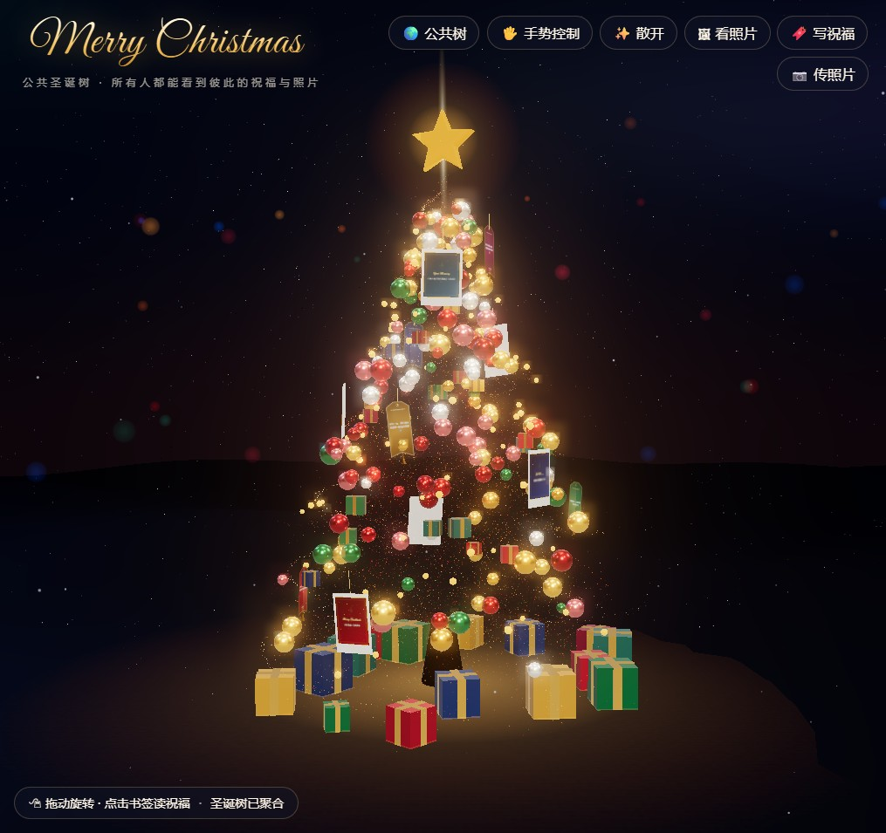

# 🎄 Gesture Christmas Tree (Three.js + MediaPipe)

一个基于 **Three.js + MediaPipe Hands** 的 3D 交互式光影粒子圣诞树 Web 应用，支持摄像头手势控制散开/聚合、展示树中照片与 3D 匿名祝福书签，内置轻量 Python 后端支持全员共享共创与可选多空间密码隔离，零 Node.js 构建依赖，全部前端与 AI 资源均支持自托管。

## 📸 效果预览

| 🎄 光影粒子圣诞树（聚合态） | ✨ 手掌张开 · 星河散开态 |
| :---: | :---: |
|  |  |
| **👌 OK 手势 · 拍立得照片特写** | **✌️ 比耶 / B 键 · 3D 祝福书签飞出阅读** |
|  |  |

## ✨ 核心特性

- **奢华光影粒子圣诞树**
  - 2.2 万+ 分层松针发光粒子、双螺旋流光丝带、上升金色星尘、金属饰球、暖光灯珠、礼盒与星芒树顶。
  - ACES 色调映射 + 定向 Bloom 辉光 + 深邃冬夜星空极光背景 + 三层景深 GPU 飘雪。
- **摄像头手势交互（MediaPipe 本地按需加载，零外部 CDN 依赖）**
  - `✋ 张开手掌`：圣诞树化作星河散开
  - `✊ 握拳`：星河重新聚合成圣诞树
  - `👌 OK 手势`（散开状态）：拉出树中的拍立得照片高亮展示，再次比 OK 切换下一张
  - `✌️ 比耶 / 剪刀手`：取出树上的 3D 祝福书签飞到眼前阅读，再次比耶循环切换
  - `↔ 手掌移动`：柔和旋转与微调视角
- **3D 匿名祝福书签（物理摆动 + 弧线飞出）**
  - 顶部打孔穿绳真实支点悬挂 + 多频自然微风摆动 + 底部金珠流苏延迟二级摆动。
  - 点击任意书签或按 `B` / `✌️` 手势，3D 书签沿立体弧线飞至镜头前（支持鼠标视差微倾与左右翻页）；新挂祝福带许愿灯式旋升入场与金色星尘爆发。
- **全员共创 + 可选专属隔离空间（`?tree=<slug>`）**
  - 默认主路径为 **公共圣诞树**：所有访客免口令即可写匿名祝福、上传照片（自动按 EXIF 旋转并压缩至 `1280px` 内，单 IP 限频防刷）。
  - 支持随时创建独立的隔离圣诞树（可选设 PBKDF2 加盐访问密码），不同空间的照片与祝福完全隔离、无刷新切换。
  - 站长输入管理口令后可在抽屉内审核并删除任意照片、祝福或房间。
- **桌面与移动端全适配**
  - 完整键盘/鼠标兜底：`空格` 散开/聚合、`P` 看照片、`B` 看书签、`← / →` 切书签、`Esc` 收起。
  - 手机竖屏自动按宽高双向适配横向宽图与书签，自托管 Great Vibes 艺术花体字体（`.woff2`）全端统一渲染。

---

## 🚀 本地快速启动

环境要求：**Python 3.10+** 与 **Pillow**（无需 Node.js / Docker）。

```bash
# 1. 安装图片处理依赖
pip install pillow

# 2. 拉取 Three.js、MediaPipe Hands (WASM + 模型) 与艺术字体到 web/vendor/
python tools/fetch_vendor.py

# 3. 启动本地开发服务（同时托管静态前端与后端 API）
# Linux / macOS:
XMAS_ADMIN_TOKEN=dev123 python server/app.py --port 8099 --data data-dev --static web

# Windows PowerShell:
$env:XMAS_ADMIN_TOKEN="dev123"; python server/app.py --port 8099 --data data-dev --static web
```

浏览器打开 `http://localhost:8099/` 即可体验（`localhost` 下可直接调起摄像头）。

---

## 🧪 运行单元测试

```bash
python -m unittest discover -s server -p "test_*.py" -v
```

---

## 🖥️ Linux 生产部署（Nginx + systemd）

```bash
# 1. 打包发布包（自动生成 .gz 静态预压缩文件以配合 Nginx gzip_static）
python tools/package_release.py

# 2. 上传 release.tar.gz 到 Linux 服务器并解压到 /tmp/xmas-tree-release
mkdir -p /tmp/xmas-tree-release && tar -xzf release.tar.gz -C /tmp/xmas-tree-release

# 3. 一键部署（配置 systemd 常驻服务与 Nginx 8444 HTTPS / 127.0.0.1:8084 HTTP）
sudo XMAS_USER=$USER bash /tmp/xmas-tree-release/deploy/setup.sh
```

> ⚠️ 浏览器安全策略要求公网必须通过 **HTTPS** 访问才能开启摄像头手势识别。`nginx-xmas-tree.conf` 同时提供 `8444` 自签 HTTPS 端口与 `127.0.0.1:8084` 明文回源端口（方便配合带自动 HTTPS 证书的反向代理或内网穿透使用）。站长管理口令保存在 `/etc/xmas-tree.env`。

---

## 📁 项目结构

```text
├── server/
│   ├── app.py               # Python 标准库 + Pillow 后端（照片、祝福、多空间隔离、限频）
│   └── test_app.py          # 后端单元测试
├── web/
│   ├── index.html           # 页面与弹窗结构
│   ├── style.css            # 玻璃拟态 UI 与移动端适配样式
│   ├── js/
│   │   ├── main.js          # Three.js 场景入口、Bloom 后处理、交互状态机
│   │   ├── tree.js          # 粒子圣诞树、双螺旋流光、饰球、礼盒、星顶
│   │   ├── environment.js   # 冬夜星空、极光、雪地反光与多层飘雪着色器
│   │   ├── photos.js        # 3D 拍立得照片墙与聚焦动画
│   │   ├── wishes.js        # 3D 许愿书签物理摆动、弧线飞出与星尘粒子
│   │   ├── gestures.js      # MediaPipe 21 点手势分类（张掌/握拳/OK/比耶）
│   │   ├── hands.js         # 摄像头与 MediaPipe 按需并行加载封装
│   │   ├── ui.js            # 空间切换、上传抽屉、祝福墙与站长管理交互
│   │   └── util.js          # 公共数学、插值与程序纹理工具
│   └── vendor/              # 第三方静态资源（由 tools/fetch_vendor.py 生成，不入库）
├── tools/
│   ├── fetch_vendor.py      # 一键下载 Three.js / MediaPipe / Great Vibes 字体
│   └── package_release.py   # 打包并生成最高级 gzip 静态预压缩文件
└── deploy/
    ├── nginx-xmas-tree.conf # Nginx 静态托管、MIME、强缓存与反代配置
    ├── xmas-tree.service    # systemd 守护进程配置
    └── setup.sh             # Linux 服务器一键部署脚本
```

## 📄 License

[MIT](./LICENSE)
